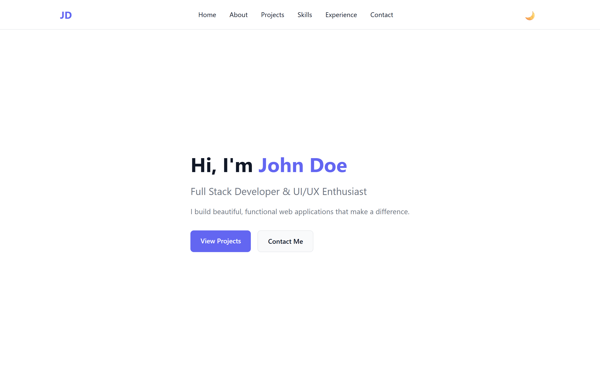
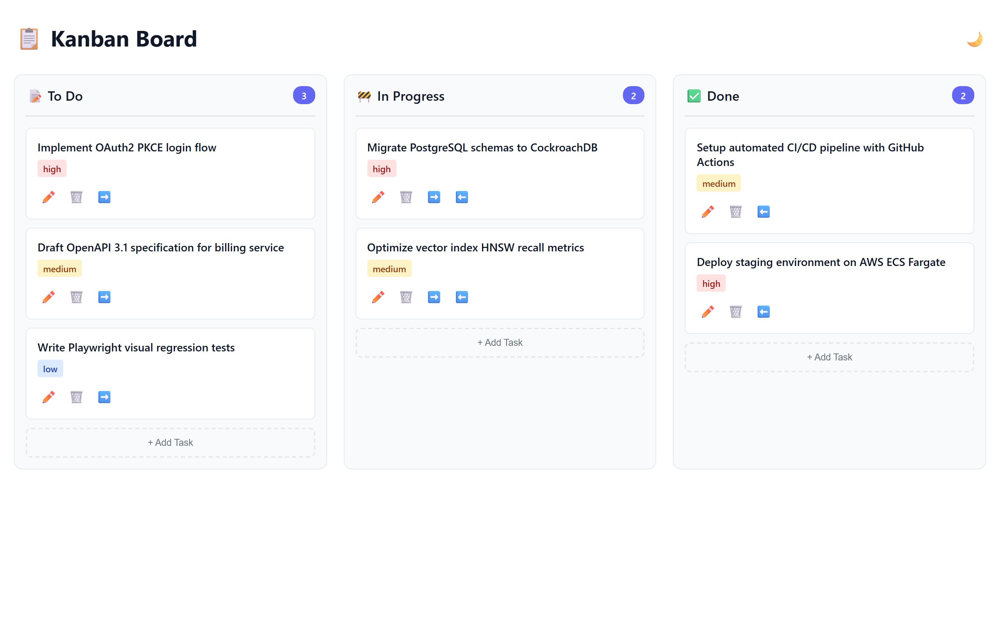
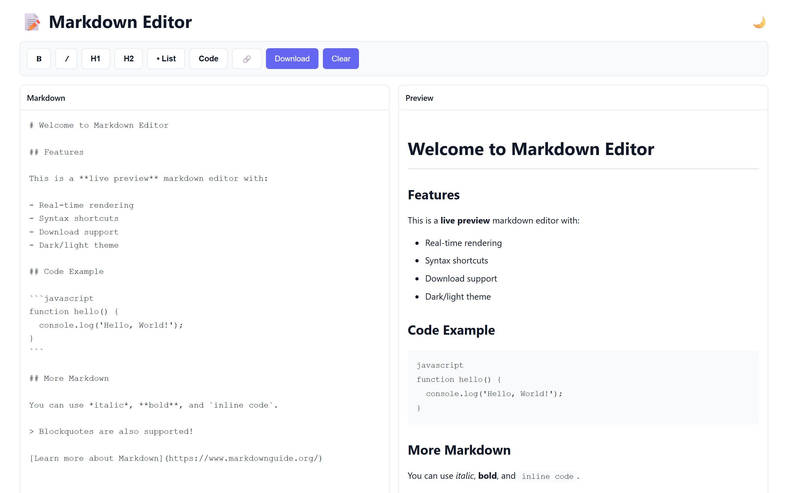
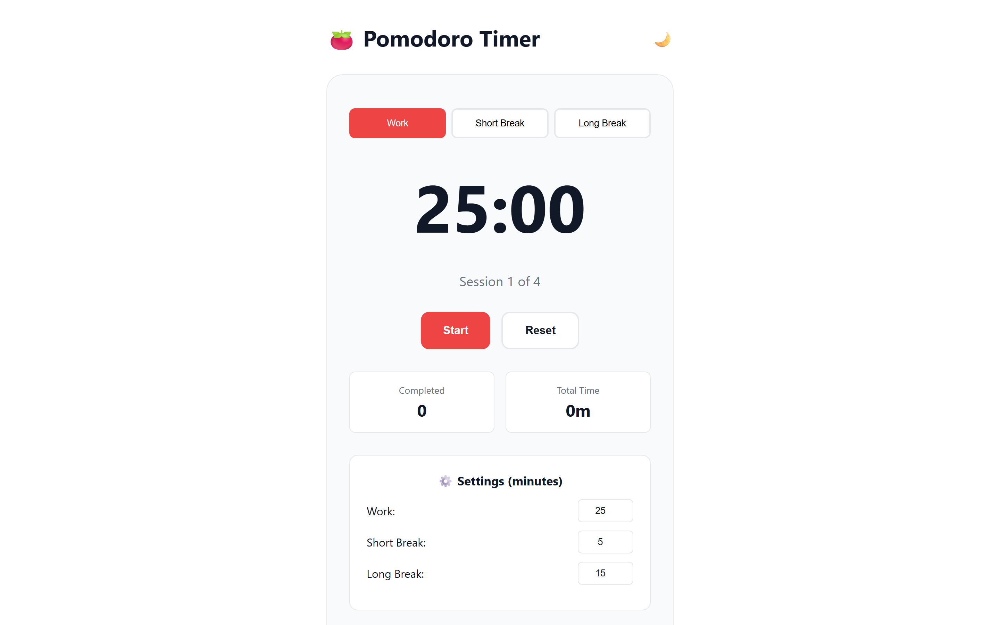
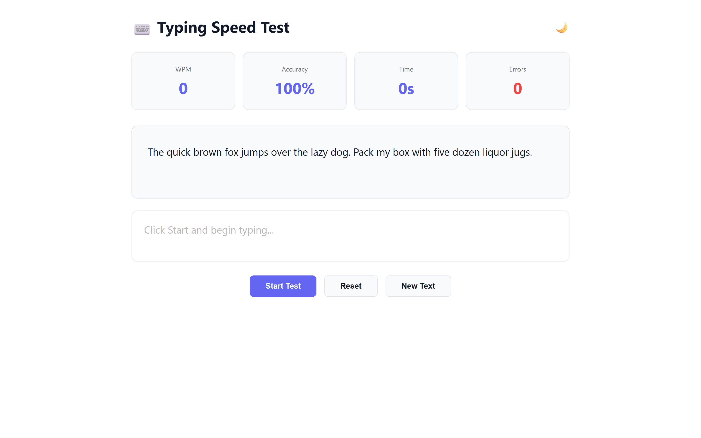

# Web Mini Projects

A collection of 15+ production-quality mini web applications built with HTML, CSS, and Vanilla JavaScript.

Repository: https://github.com/0xyz-exe/web-mini-projects

## Screenshots

### 1. Modern Developer Portfolio
Landing page portofolio personal dengan navigasi terstruktur, hero banner, badge keahlian, dan tombol interaksi cepat:


### 2. Kanban Drag-and-Drop Task Board
Papan manajemen tugas interaktif 3 kolom (To Do, In Progress, Done) dengan badge prioritas, aksi perpindahan kartu, dan penghitung tugas real-time:


### 3. Live Markdown Editor & Preview
Editor Markdown split-pane 50/50 dengan live HTML preview parser, toolbar pemformatan teks, dan ekspor unduhan `.md`:


### 4. Pomodoro Productivity Timer
Aplikasi pengatur waktu produktivitas dengan siklus kerja dan jeda istirahat (Work, Short Break, Long Break), penghitung sesi, dan statistik waktu:


### 5. Typing Speed Test & WPM Measurement
Uji kecepatan mengetik interaktif dengan pengukuran Words Per Minute (WPM), akurasi persentase, penghitung kesalahan, dan deteksi waktu respons:


## 🚀 Projects Overview

| # | Project | Description | Key Features |
|---|---------|-------------|--------------|
| 01 | [Interactive Portfolio](projects/01-portfolio/) | Modern developer portfolio | Hero, projects, skills, timeline, contact |
| 02 | [Task Manager](projects/02-task-manager/) | Complete task management | CRUD, priorities, filters, localStorage |
| 03 | [Expense Tracker](projects/03-expense-tracker/) | Income/expense tracking | Categories, charts, export/import |
| 04 | [Weather Dashboard](projects/04-weather-dashboard/) | Real-time weather data | Open-Meteo API, forecasts, geolocation |
| 05 | [Quiz Application](projects/05-quiz-app/) | Interactive quiz engine | Multiple choice, timer, scoring, review |
| 06 | [Markdown Editor](projects/06-markdown-editor/) | Live markdown preview | Formatting toolbar, safe rendering, download |
| 07 | [Password Generator](projects/07-password-generator/) | Secure password creation | Crypto API, strength meter, customizable |
| 08 | [Pomodoro Timer](projects/08-pomodoro-timer/) | Productivity timer | Work/break cycles, notifications, tracking |
| 09 | [Notes Application](projects/09-notes-app/) | Full-featured notes | Pin, search, export/import, localStorage |
| 10 | [Image Gallery](projects/10-image-gallery/) | Responsive gallery | Local upload, categories, lightbox, keyboard nav |
| 11 | [Calculator Suite](projects/11-calculator/) | Functional calculator | Keyboard support, error handling |
| 12 | [Typing Speed Test](projects/12-typing-test/) | WPM measurement | Real-time feedback, accuracy, multiple texts |
| 13 | [GitHub Explorer](projects/13-github-explorer/) | GitHub profile viewer | User search, repos, stats via GitHub API |
| 14 | [Kanban Board](projects/14-kanban-board/) | Drag-and-drop tasks | 3 columns, priorities, accessible controls |
| 15 | [JSON Formatter](projects/15-json-formatter/) | JSON validator & formatter | Validate, format, minify, syntax errors |

## 🛠️ Technologies

- **HTML5** - Semantic markup, modern APIs
- **CSS3** - Grid, Flexbox, Custom Properties, Animations
- **Vanilla JavaScript** - ES6+, no frameworks
- **Browser APIs** - localStorage, Fetch, Notifications, Drag & Drop, Web Crypto

## 📦 Installation

### Prerequisites

- Modern web browser (Chrome, Firefox, Safari, Edge)
- Optional: Local web server for ES modules (Python, Node.js, or VS Code Live Server)

### Running Projects

**Option 1: Direct File Access**

```bash
cd web-mini-projects
# Open any project's index.html in your browser
# Or open the root index.html for the gallery
```

**Option 2: Local Server (Recommended)**

Using Python:
```bash
cd web-mini-projects
python -m http.server 8000
# Open http://localhost:8000
```

Using Node.js (http-server):
```bash
cd web-mini-projects
npx http-server -p 8000
# Open http://localhost:8000
```

Using VS Code:
- Install "Live Server" extension
- Right-click `index.html` → "Open with Live Server"

## 🧪 Testing

### Manual Testing

Each project can be tested individually by opening its `index.html` file.

### Automated Checks

Run the quality check script:

**PowerShell:**
```powershell
.\scripts\check-projects.ps1
```

**Bash/Git Bash:**
```bash
bash scripts/check-projects.sh
```

The script verifies:
- All 15 required projects exist
- Each project has HTML, CSS, JS, and README
- JavaScript syntax validation (if Node.js available)
- Internal link checking

## 🎨 Features

### Common Features Across Projects

- 🌓 **Dark/Light Theme** - All projects support theme toggle with localStorage persistence
- 📱 **Responsive Design** - Mobile, tablet, and desktop layouts
- ♿ **Accessibility** - Semantic HTML, ARIA attributes, keyboard navigation
- 💾 **Data Persistence** - localStorage for client-side data storage
- 🎯 **Modern UI** - Clean, professional design with consistent styling
- ⚡ **Performance** - Lightweight, fast loading, no external dependencies

### Security Considerations

- User input is escaped before rendering to prevent XSS
- No use of `eval()` or `new Function()`
- Crypto API used for secure random generation
- Safe JSON parsing without code execution
- No hardcoded secrets or API keys

## 📂 Project Structure

```
web-mini-projects/
├── index.html              # Project gallery/homepage
├── README.md               # This file
├── LICENSE                 # MIT License
├── .gitignore
├── assets/
│   ├── css/
│   │   └── shared.css      # Shared styles
│   ├── js/
│   └── images/
├── projects/
│   ├── 01-portfolio/
│   │   ├── index.html
│   │   ├── style.css
│   │   ├── script.js
│   │   └── README.md
│   ├── 02-task-manager/
│   ├── ... (03-15)
│   └── 15-json-formatter/
├── scripts/
│   ├── check-projects.ps1  # Quality checks (PowerShell)
│   └── check-projects.sh   # Quality checks (Bash)
└── tests/
    └── README.md
```

## 🌐 GitHub Pages Deployment

1. Push repository to GitHub
2. Go to repository Settings → Pages
3. Set source to `main` branch, root directory
4. Access at `https://<username>.github.io/web-mini-projects/`

All projects use relative paths and are compatible with static hosting.

## 🔒 Privacy & Data Storage

- **All data stored locally** - No external data transmission
- **localStorage** - Projects use browser localStorage for persistence
- **No analytics** - No tracking or telemetry
- **API Usage** - Weather (Open-Meteo) and GitHub Explorer use public APIs with no authentication

## 📝 Browser Compatibility

Tested and working on:
- Chrome/Edge 90+
- Firefox 88+
- Safari 14+

## 🐛 Known Limitations

- localStorage has 5-10MB limit (affects Image Gallery with many large images)
- GitHub API has 60 requests/hour rate limit for unauthenticated requests
- Weather API requires internet connection for live data
- Notifications require user permission

## 🤝 Contributing

This is a showcase project. Feel free to fork and customize for your own use.

## 📄 License

MIT License - see [LICENSE](LICENSE) file for details.

## 🙏 Acknowledgments

- Open-Meteo for free weather API
- GitHub for public API access
- Modern browser APIs for powerful native functionality

## 📧 Contact

Built as a demonstration of modern web development with vanilla JavaScript.

---

**Last Updated:** October 2026

**Status:** ✅ All 15 projects complete and functional
